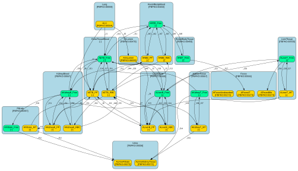

# Cadmium PBK model 

This repository contains a (FAIR) Antimony/SBML reimplementation of the cadmium PBK model developed by [Cui et al. (2026)](https://doi.org/10.1016/j.envint.2026.110150) in accordance with the [FAIR PBK standard](https://doi.org/10.1016/j.comtox.2026.100426). The resulting SBML (FAIR) representation of the model is provided in [pbk_cd_cui_2026.sbml](model/pbk_cd_cui_2026.sbml). A diagram of the model compartments and species is shown below.




## SBML/Antimony model implementation

The file [pbk_cd_cui_2026.ant](model/pbk_cd_cui_2026.ant) contains the Antimony implementation of the model. Conversion to the annotated SBML file is done through the script [create_sbml.py](scripts/create_sbml.py). This script first converts the Antimony model implementation to SBML and then annotates this SBML file using the annotations specified in the [pbk_cd_cui_2026.annotations.csv](model/pbk_cd_cui_2026.annotations.csv) file.


## Running the scipts

### Prerequisites

To run scripts you will need Python installed on your system, along with several additional packages. You can install these packages using the following command:

```
pip install -r requirements.txt
```

### Compile model

To convert the Antimony model implementation to SBML and annotates it, type:

```
python ./scripts/compile_model.py
```

### Create model docs

To create the [model documentation page](docs/pbk_cd_cui_2026.report.md), type:

```
python ./scripts/create_report.py
```

### Run validation scenarios

To run the run simulation scenarios, type:

```
python ./scripts/run_validation.py
```

By default, this script reuses existing outputs from previous runs. To override and recalculate outputs that already exist, use the `-f` option.

To run the run simulation scenarios for a specific scenario config (e.g. thos defined in [validation/scenarios/R.yaml](validation/scenarios/R.yaml)), type:

```
python ./scripts/run_validation.py -c validation/scenarios/R.yaml
```
